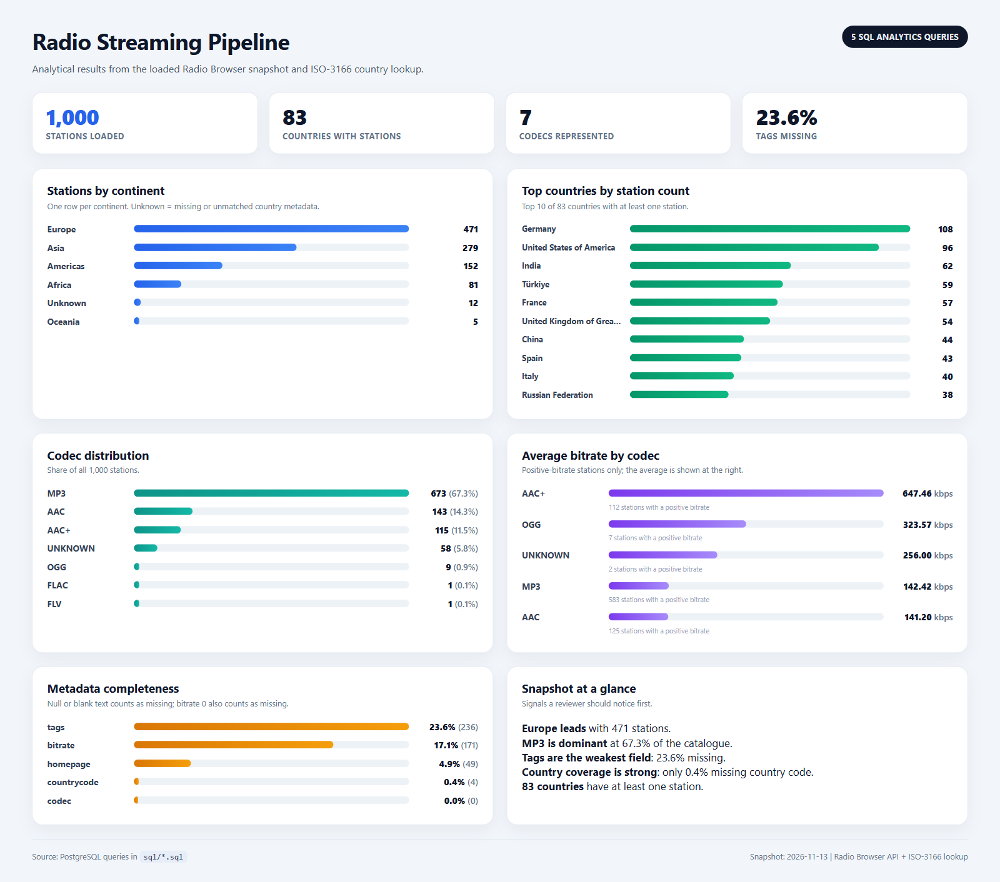

# Radio Streaming Pipeline

A reproducible batch ETL pipeline for live radio station metadata. It fetches a
snapshot from the [Radio Browser API](https://api.radio-browser.info/), downloads
an ISO-3166 country lookup, cleans the station records, and loads both the
country lookup and the station rows into PostgreSQL. Analytical SQL joins the
two tables.

## Status

The pipeline is complete. Extract, transform, load, all five analytical SQL
queries, and the test suite are implemented. `python run_pipeline.py` runs the
full sequence: extract, transform/load, analytics, and tests. The test suite
passes: `7 passed`.

## Snapshot



Current analytical output from the loaded snapshot. The image contains only the
results of the five analytics queries, not the test output.

## Problem

The Radio Browser API is a live, messy catalogue of internet radio stations.
Answering basic questions about the catalogue requires cleaning blank country
codes, zero bitrates, inconsistent codecs, duplicate station UUIDs, and
comma-separated tags.

The pipeline answers five questions:

| Question | SQL file |
| --- | --- |
| Which continents have the most stations? | `sql/stations_by_continent.sql` |
| Which countries have the most stations? | `sql/stations_by_country.sql` |
| Which codecs dominate the catalogue? | `sql/codec_distribution.sql` |
| What is the average bitrate by codec? | `sql/avg_bitrate_by_codec.sql` |
| How much metadata is missing? | `sql/metadata_completeness.sql` |

The country lookup is loaded into its own table. The station table keeps only a
`countrycode` foreign key, and the analytical queries join the two tables. The
pipeline does not duplicate country metadata on every station row.

## Data sources

| Source | Type | Location | Used by |
| --- | --- | --- | --- |
| Radio Browser API | Live REST API | `https://de1.api.radio-browser.info` | `scripts/extract.py` |
| Country lookup | Local CSV download | `data/raw/country_lookup.csv` (gitignored) | `scripts/extract.py` and `scripts/transform.py` |

The country lookup is downloaded by `scripts/extract.py` from a pinned ISO-3166
source. It is not committed because `data/raw/` is gitignored. A fresh clone
must run the extract stage before the transform stage.

## Architecture

```text
run_pipeline.py
      |
      +--> scripts/extract.py
      |      Radio Browser API -> data/raw/stations_<timestamp>.json
      |      Country lookup     -> data/raw/country_lookup.csv
      |
      +--> scripts/load.py
      |      scripts/transform.py (clean + validate)
      |      -> country table + stations table
      |
      +--> scripts/run_analytics.py
      |      sql/*.sql -> printed result sets
      |
      `--> pytest
             tests/test_pipeline.py
```

`scripts/load.py` calls `run_transform()` and then `run_load()`, so the second
pipeline step performs the transform and load stages together.

## Setup

### Prerequisites

- Python 3.10+
- PostgreSQL running locally
- A PostgreSQL user that can create tables

### 1. Create the database

```sql
CREATE DATABASE radio_pipeline;
```

If the database already exists, skip this step.

### 2. Clone and install

```powershell
git clone https://github.com/raxxivr/radio-streaming-pipeline.git
cd radio-streaming-pipeline

python -m venv .venv
.\.venv\Scripts\Activate.ps1
pip install -r requirements.txt
```

On bash:

```bash
git clone https://github.com/raxxivr/radio-streaming-pipeline.git
cd radio-streaming-pipeline

python -m venv .venv
source .venv/bin/activate
pip install -r requirements.txt
```

### 3. Configure the environment

```powershell
Copy-Item .env.example .env
```

Edit `.env` and set `DB_PASSWORD`:

```text
DB_HOST=localhost
DB_PORT=5432
DB_NAME=radio_pipeline
DB_USER=postgres
DB_PASSWORD=your-password
```

`.env` is gitignored. Only `.env.example` with placeholder values is committed.

### 4. Run the pipeline

Run all stages in order:

```powershell
python run_pipeline.py
```

This runs extract, transform/load, analytics, and tests. A failure stops the
pipeline immediately.

The stages can also be run individually for debugging:

```powershell
python -m scripts.extract
python -m scripts.load
python -m scripts.run_analytics
```

The transform stage can be run alone for inspection:

```powershell
python -m scripts.transform
```

### 5. Run the tests

```powershell
pytest -q
```

The tests import the real ETL modules but mock `requests.get` and the database
write functions. They do not call the live API or modify PostgreSQL.

## Analytics

The five SQL files are implemented. Run each one on its own:

```powershell
psql -U postgres -d radio_pipeline -f sql/stations_by_continent.sql
psql -U postgres -d radio_pipeline -f sql/stations_by_country.sql
psql -U postgres -d radio_pipeline -f sql/codec_distribution.sql
psql -U postgres -d radio_pipeline -f sql/avg_bitrate_by_codec.sql
psql -U postgres -d radio_pipeline -f sql/metadata_completeness.sql
```

The queries use two join patterns:

- `stations_by_continent.sql` starts from `stations` and left joins `country`, so
  stations without a matched country code stay in the `Unknown` bucket.
- `stations_by_country.sql` starts from `stations` and joins `country`, so it
  returns only countries with at least one station.

The generic analytical join is:

```sql
SELECT
    s.*,
    c.country_name,
    c.continent,
    c.sub_region
FROM stations AS s
LEFT JOIN country AS c
    ON s.countrycode = c.country_code;
```

### Sample results

Current snapshot: 1,000 stations.

| Query | Current result |
| --- | --- |
| Continent | Europe 471, Asia 279, Americas 152, Africa 81, Unknown 12, Oceania 5 |
| Country | 83 countries; DE 108, US 96, IN 62 |
| Codec | MP3 67.3%, AAC 14.3%, AAC+ 11.5% |
| Avg bitrate | AAC+ 647.46 kbps over 112 stations |
| Metadata | tags 23.6% missing, bitrate 17.1% missing |

## Reruns and raw data

Each run is a full refresh:

- `extract.py` writes one new timestamped JSON file per run.
- `load.py` truncates `country` and `stations` before loading the current
  snapshot.
- `country` is truncated with `CASCADE`, so it also clears `stations`; the
  loader fills `country` first and `stations` second to satisfy the foreign key.
- Reruns do not append duplicate rows.

`data/raw/` is gitignored. Only `extract.py` writes there; the transform and load
stages only read from it.

## Project layout

```text
radio-streaming-pipeline/
|-- data/
|   `-- raw/                      # generated JSON + downloaded country CSV (gitignored)
|-- docs/
|   |-- analytics_results.png     # analytics dashboard used in this README
|   |-- erd.md                    # normalized ERD and SQL joins
|   `-- project_guide.md          # implementation plan and current status
|-- scripts/
|   |-- extract.py                # API fetch + country CSV download
|   |-- transform.py              # clean stations and validate country codes
|   |-- load.py                   # create tables and load PostgreSQL
|   `-- run_analytics.py          # execute and print the five SQL queries
|-- sql/
|   |-- stations_by_continent.sql
|   |-- stations_by_country.sql
|   |-- codec_distribution.sql
|   |-- avg_bitrate_by_codec.sql
|   `-- metadata_completeness.sql
|-- tests/
|   `-- test_pipeline.py          # ETL tests (API and DB writes mocked)
|-- .env                          # local values (gitignored)
|-- .env.example
|-- .gitignore
|-- README.md
|-- requirements.txt
`-- run_pipeline.py               # full pipeline entry point
```

## Limitations

- The snapshot is a sample ordered by clickcount, not a full census of all
  stations.
- The API is live, so two extract runs can return different rows.
- There is no scheduler or continuous polling loop yet.
- The test suite mocks database writes, so it does not verify live PostgreSQL
  connectivity.
- Existing databases created before the schema cleanup may still contain the old
  unused `country_name`, `continent`, and `sub_region` columns on `stations`;
  `CREATE TABLE IF NOT EXISTS` does not alter an existing table.
- Raw data is not committed, so a fresh clone must run extract before transform.
- The analytics dashboard reflects the current snapshot; refreshing the data
  changes the numbers.

## Implementation plan

See [`docs/project_guide.md`](docs/project_guide.md) for the phase-by-phase plan,
current status, acceptance criteria, and next actions.
