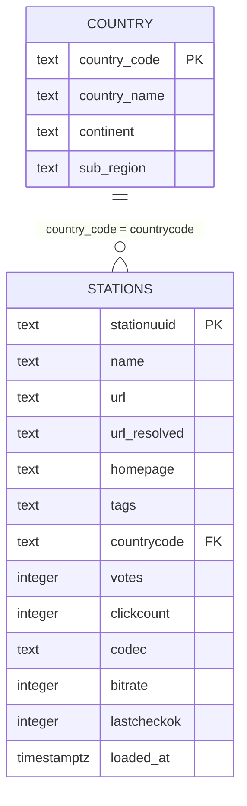

# Entity-Relationship Diagram

The pipeline has two source objects and two PostgreSQL tables. The country
lookup is loaded into `country`; station rows are loaded into `stations`.
Analytical SQL joins the two tables on `countrycode`.



## Join

```sql
SELECT
    s.*,
    c.country_name,
    c.continent,
    c.sub_region
FROM stations AS s
LEFT JOIN country AS c
    ON s.countrycode = c.country_code;
```

## Query join patterns

The analytical queries start from `stations` so the station grain is preserved.

```sql
-- Continent analysis: keep stations without a matched country code.
FROM stations AS s
LEFT JOIN country AS c
    ON s.countrycode = c.country_code;

-- Country analysis: return only countries with at least one station.
FROM stations AS s
JOIN country AS c
    ON s.countrycode = c.country_code;
```

## Notes

- The schema is normalized: country metadata lives in `country`, not in
  `stations`.
- `countrycode` is nullable and references `country.country_code`.
- The continent query uses a left join and places stations without a matched
  country code into the `Unknown` bucket.
- The country query uses an inner join, so it excludes stations with a null or
  unmatched country code.
- `AQ` (Antarctica) and `TW` (Taiwan) have blank `continent` and `sub_region`
  in the upstream lookup. The blanks are preserved rather than invented and are
  grouped as `Unknown` in the continent query.
- The `stations` table no longer contains the old `country_name`, `continent`,
  and `sub_region` columns. Existing databases created before that cleanup may
  still have them; `CREATE TABLE IF NOT EXISTS` does not alter an existing
  table.
