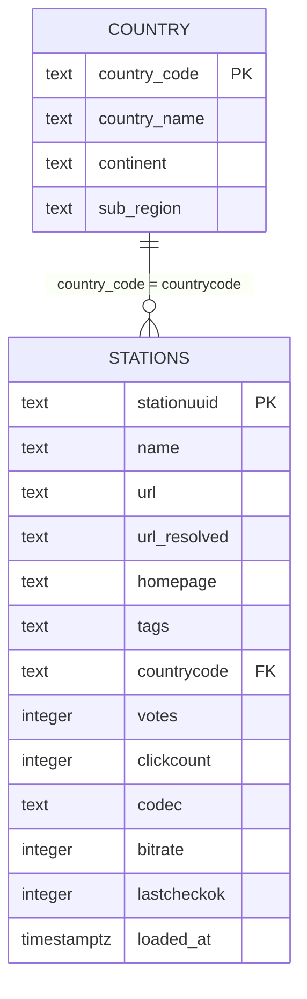

# Entity-Relationship Diagram

The pipeline has two source objects and two PostgreSQL tables. The country
lookup is loaded into `country`; station rows are loaded into `stations`.
Analytical SQL joins the two tables on `countrycode`.



## Join

```sql
SELECT
    s.*,
    c.country_name,
    c.continent,
    c.sub_region
FROM stations AS s
LEFT JOIN country AS c
    ON s.countrycode = c.country_code;
```

## Notes

- The join is a **left join**. Stations with a blank or unknown `countrycode`
  stay in the result with null country metadata.
- `AQ` (Antarctica) and `TW` (Taiwan) have blank `continent` and `sub_region`
  in the upstream lookup. The blanks are preserved rather than invented.
- The target schema is normalized: country metadata lives in `country`, not in
  `stations`.
- `scripts/load.py` currently creates three unused denormalized columns on
  `stations` (`country_name`, `continent`, `sub_region`). They are not populated
  by the transform. Remove them in a follow-up migration and use the `country`
  table for analytics.
- `countrycode` is nullable and references `country.country_code`.
